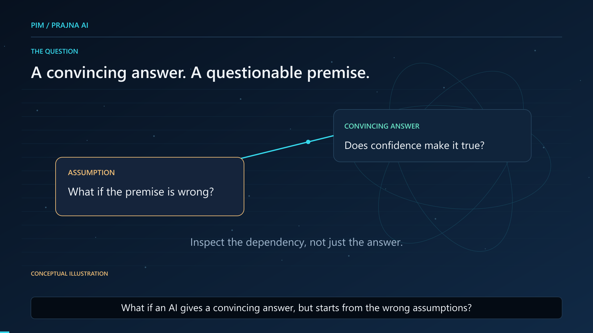

# Prajna Insight Model (PIM) / Prajna AI

**Research and engineering status: 2026-11-09 (Asia/Taipei).**

PIM studies how to make AI reasoning inspectable: keep task assumptions explicit, check candidate answers separately from reasoning proposals, account for control costs, and preserve evidence when a run fails or remains uncertain. The existing research prototype combines bounded symbolic search, constraint-preserving cognitive reframing (CPCR), rule-based cost-aware insight gating (CAIG), finite verification, and execution records.

Prajna AI is the broader research program. Its v0.3 direction, the Unified Insight Process (UIP), connects hypothesis formation, evidence-oriented checking, and revision. Autonomous scientific discovery is a research objective, not an established capability. This repository is not a newly trained foundation LLM, and current evidence does not establish superiority over reasoning LLMs.

## Start here

- [Development status and test boundaries — 2026-11-09](docs/development-status-2026-11-09.md)
- [Architecture: implemented components and proposed integration](docs/architecture-and-scope.md)
- [Roadmap, milestones, and acceptance gates](docs/roadmap-and-gates.md)
- [Evidence availability and verification limits](docs/evidence-and-reproducibility.md)
- [Public showcase quick start](showcase/docs/quickstart.md) · [Documentation changelog](CHANGELOG.md)

## Current development stage

| Area | Evidence-backed status at the cutoff |
| --- | --- |
| Public distribution | A selected **33-file historical showcase** plus the v0.2 film and project documentation. It does not contain the complete development workspace. |
| P0 Foundation L1 | **SOURCE_PREPARED_DYNAMIC_NOT_RUN**: 26 source files, seven private audit files and one plan prepared. Source-text review was acceptable with limits. |
| Foundation implementation and tests | **Six Runtime Core files are absent; all 64 new acceptance tests are NOT_RUN.** G0 and G1 have not passed; L2 execution is not authorized. |
| Human-conditioned evaluation | IW-03-SCORE01 has a **historical bounded 73/73 product/regression PASS**, with 17 control cases and 111 subtests counted separately. This is not the Foundation's test suite. |
| Other bounded prototypes | Human-reference review, contract proposal/preview packaging, a private single-contract confirmation/adoption demonstration, and a scripted three-policy offline prototype have scoped historical evidence. |
| Runtime reliability | IW-01/HOST remain blocked; native CORE validation is NOT_RUN. Portable integration and IW-02 control sources have not completed dynamic acceptance. |
| Scientific conclusions | General semantic fidelity, reasoning superiority, optimal gating, and autonomous scientific discovery remain unestablished. |

No product test or research experiment was run for this documentation update. Detailed package statuses and provenance are in the [dated status report](docs/development-status-2026-11-09.md). Private evidence is summarized as such; it is not presented as a publicly reproducible release.

## PIM / Prajna AI v0.2 — English animated explainer

**What if an AI gives a convincing answer, but starts from the wrong assumptions?**

[Watch on YouTube](https://www.youtube.com/watch?v=7fXS9Q3H0HA) · [Complete 1080p MP4](media/research-film/PIM-Prajna-AI-v02-English-Explainer-1080p-v01.mp4) · [Film guide and research scope](docs/research-film.md) · [English subtitles](media/research-film/captions.en.srt) · [Media integrity manifest](media/research-film/manifest.json)

This 3-minute-53-second animated introduction presents the v0.2 roadmap: testable hypotheses, active experimentation, and an evidence-based reasoning loop. It distinguishes bounded implemented prototypes and engineering evidence from proposed research. The full original English narration is retained; AI-assisted motion graphics and an authorized presenter portrait provide the visuals, without lip sync.

The film covers the broader research program. It does not imply that all roadmap capabilities are implemented in the [public showcase](showcase/README.md), or that PIM is a newly trained foundation LLM or has demonstrated general reasoning superiority.

The film remains a dated v0.2 overview. Use the November 9 status and roadmap above for subsequent v0.3/UIP and Foundation work.

## What is available to inspect

The [showcase](showcase/README.md) includes finite contract/reference checks, non-authorizing contract proposals, and four offline scenarios illustrating contract/reference disagreement, conditional answers, UNKNOWN verification, and PROPOSED-only contracts. Its existing source and tests are preserved as a historical snapshot.

The original showcase guides retain their preparation-time descriptions, including private-candidate and pending-release language. Public availability now establishes that those selected files can be inspected; it does not retroactively establish a full release-verification gate. The [current evidence guide](docs/evidence-and-reproducibility.md) distinguishes the two.

New Foundation sources, restricted reference answers, private human responses, operational trust records, internal audits, and full Pilot traces are not distributed here.

## Historical development-pilot results

| System | Verified Success Rate | Mean accounted cost (units) |
| --- | ---: | ---: |
| B0 | 79.07% | 923.79 |
| B1 | 79.81% | 796.90 |
| PIM | 60.37% | 1294.22 |

These are preserved historical development-pilot observations for this implementation and experimental configuration. PIM had a lower observed success rate and higher mean accounted cost than both baselines. These results do not establish the general causal benefit or ineffectiveness of cognitive reframing.

The benchmark contains 180 tasks across 15 families, partitioned into 108 development, 36 validation, and 36 held-out tasks. The historical pilot evaluated nine development families: 108 tasks, five seeds, and eight policies produced 4,320 records. The paired 4,320 rerun records check consistency and are not additional independent experimental observations. Tasks, families, and seeds have statistical dependence. Accounted cost units are defined by the research cost model and are not a universal token, currency, or hardware-time measure. Validation and held-out confirmation remain incomplete.

Exploratory statistical diagnostics do not support a confirmatory difference claim; a non-significant result also does not establish equivalence. A future equivalence claim would require a scientifically justified margin, an appropriate test, and treatment of task-family dependence. See the [evidence and limitations guide](docs/evidence-and-reproducibility.md).

## Research integrity and AI assistance

A finite preservation certificate is separate from answer validity, resource compliance, and agreement with human intent. Replay consistency is separate from oracle correctness, durable storage, and external replication. UNKNOWN is retained when evidence is insufficient.

ChatGPT and OpenAI Codex have extensively assisted with research discussions, specifications, software, tests, analysis, documentation, translation, and manuscript preparation. Human decisions and actual review responses are kept separate from AI-generated material. Separate AI reviewer contexts are not independent human scientific review. Complete per-expression and per-passage provenance remains partial.

Historical successes, failures, negative results, and unknowns remain part of the record. Source preparation, engineering acceptance, scientific validation, and publication approval are separate decisions.

## Participation and material policy

Start with the [contribution guide](showcase/CONTRIBUTING.md) and [support guide](showcase/SUPPORT.md). Use [Issues](https://github.com/luciferyu666/prajna-insight-model/issues) for concrete questions or reproducible reports; identify the exact commit and distinguish public observations from private-evidence claims. Do not post credentials, restricted evaluation answers, or private review material.

New project documentation uses English. No repository-wide software license has been selected; public visibility is not a blanket redistribution license. This update changes project documentation only and does not alter material rights, access controls, historical code, or execution permissions.
