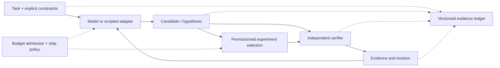

# Architecture and scope

Status cutoff: **2026-11-09**. See the [status report](development-status-2026-11-09.md) and [evidence guide](evidence-and-reproducibility.md) for the provenance behind these distinctions.

## Research positioning

PIM is a research system architecture around bounded reasoning, explicit contracts, verification and accountable control. It can be studied with symbolic or scripted components; future integration with language models is a separate engineering/evaluation task. The project has not trained or validated a new foundation model.

The historical symbolic prototype uses finite candidate search, CPCR preservation checks, rule-based CAIG, answer verification and cost accounting. A preservation certificate is conditional on its declared domain and verifier. It does not establish that a task contract correctly represents a person's original intent.

The v0.3 Unified Insight Process (UIP) is a research framing for connected hypothesis formation, evidence-oriented checking, and revision. It is not an empirical finding that a new reasoning mechanism is superior.

## Three implementation layers

| Layer | Current scope | Limit |
| --- | --- | --- |
| Published showcase | Selected finite contract/reference components, proposal handling and four offline demonstrations | Historical 33-file slice, not the complete CPCR/CAIG runtime |
| Later isolated prototypes | Conditional scoring, bounded review packets, private TA1 adoption demo, scripted three-policy MVP | Private, version-specific engineering evidence; no blanket public reproducibility or production guarantees |
| New Foundation | Task/data/event/budget schemas, synthetic fixtures and acceptance-test definitions | L1 source preparation only; six runtime modules absent, 64 tests NOT_RUN |

The older working prototypes do not automatically implement the new Foundation interfaces.

## Intended integration, not a deployed pipeline

This diagram describes the target architecture. Solid arrows are intended information flow, not claims that the complete loop exists. Active experiment selection, general hypothesis revision and the new Foundation runtime remain unfinished.

Key boundaries in the design (E02, E12):

- The generator receives the public task projection; restricted reference material belongs to the authorized verifier path.
- Candidate generation and answer verification are separate responsibilities.
- A contract change is proposed against a precise version. A proposal or an unverified statement cannot silently replace an adopted contract.
- Predictions and chosen experiments should be recorded before outcomes are used for revision.
- Budget reservations, denials, unknown use and violations must remain distinguishable. Later accounting must not erase an earlier violation or create permission.
- Evidence events need explicit subject identity, ordering, provenance and failure states.

These are interface/acceptance requirements until the relevant implementation and dynamic tests pass. Loader boundaries are not OS isolation. Hash chains are not independent identity, immutable storage, crash recovery or an external journal.

## Existing demonstrations and what they establish

The public scenarios demonstrate that an answer can satisfy a declared contract while failing a finite reference, that conditional answers may leave human intent unresolved, that a verifier can return UNKNOWN, and that a changed contract can remain PROPOSED. Follow the [showcase walkthrough](../showcase/docs/demo-walkthrough.md).

The later private MVP exercises three scripted policies: a single answer, a second reflection without a new oracle, and bounded reassessment with a scripted clarification. Its operation counts are not measured LLM tokens or financial costs. Different follow-up information prevents treating it as an information-matched efficacy comparison.

The TA1 confirmation prototype demonstrates a private, single-session approve/adopt transaction under explicit local trust assumptions. It does not authenticate legal identity independently, defend against a compromised trusted operator, or authorize any future task.

## Deployment and reliability

Cloud execution is a future deployment target, not an accepted production service. Platform-neutral source preparation does not establish Linux or Windows runtime reliability. Environment admission, exact source/dependency identity, bounded execution, failure handling, cleanup evidence and independent review remain necessary.

The Windows HOST branch remains blocked and its H1 limit remains four. A separate safe validation route may establish only its approved scope; it cannot erase historical failures or silently remove original platform obligations.
