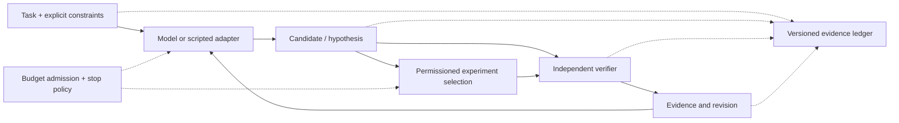

# Architecture and scope

Updated 28 November 2026. The [status report](development-status-2026-11-28.md) records the scoped engineering decisions and the [evidence guide](evidence-and-reproducibility.md) identifies their sources.

## Research positioning

PIM combines explicit task contracts, separate verification and resource accounting. The project has exercised scripted components and a frozen pretrained model on disclosed development cases. Training new weights remains a later research stage.

The historical symbolic prototype uses finite candidate search, CPCR preservation checks, rule-based CAIG, answer verification and cost accounting. A preservation certificate is conditional on its declared domain and verifier. It does not establish that a task contract correctly represents a person's original intent.

The v0.3 Unified Insight Process (UIP) is a research framing for connected hypothesis formation, evidence-oriented checking, and revision. It is not an empirical finding that a new reasoning mechanism is superior.

## Implementation scope

| Layer | Current scope | Limit |
| --- | --- | --- |
| Published showcase | Selected finite contract/reference components, proposal handling and four offline demonstrations | Historical 33-file slice, not the complete CPCR/CAIG runtime |
| Later isolated prototypes | Conditional scoring, bounded review packets, private TA1 adoption demo, scripted three-policy MVP | Private, version-specific engineering evidence; no blanket public reproducibility or production guarantees |
| D05 Foundation | Six integrated modules, with scoped acceptance for source inventory, admission, validation and the contract ledger | Fixed Linux staging and one separately admitted ledger test. Broader platform, rights and gate obligations remain open. |
| Phase A research system | Version-bound runner, three UIP operations with individual switches, a scoring contract and two isolated local review endpoints | Development evidence only. Formal blind evaluation and independent replication remain pending. |

The older working prototypes do not automatically implement the new Foundation interfaces.

## Intended integration, not a deployed pipeline

The diagram shows the intended end-to-end flow. The accepted runner exercised E0 command reconstruction, E1 controlled observation and E2/E3 zero-dispatch previews. Active experiment selection and general hypothesis revision still need scientific evaluation.

Key boundaries in the design (E02, E12):

- The generator receives the public task projection; restricted reference material belongs to the authorized verifier path.
- Candidate generation and answer verification are separate responsibilities.
- A contract change is proposed against a precise version. A proposal or an unverified statement cannot silently replace an adopted contract.
- Predictions and chosen experiments should be recorded before outcomes are used for revision.
- Budget reservations, denials, unknown use and violations must remain distinguishable. Later accounting must not erase an earlier violation or create permission.
- Evidence events need explicit subject identity, ordering, provenance and failure states.

The scoped cases exercise these interfaces. Broader isolation, crash recovery, external identity and durable independent journaling each require separate evidence.

## Existing demonstrations and what they establish

The public scenarios demonstrate that an answer can satisfy a declared contract while failing a finite reference, that conditional answers may leave human intent unresolved, that a verifier can return UNKNOWN, and that a changed contract can remain PROPOSED. Follow the [showcase walkthrough](../showcase/docs/demo-walkthrough.md).

The later private MVP exercises three scripted policies: a single answer, a second reflection without a new oracle, and bounded reassessment with a scripted clarification. Its operation counts are not measured LLM tokens or financial costs. Different follow-up information prevents treating it as an information-matched efficacy comparison.

The TA1 confirmation prototype demonstrates a private, single-session approve/adopt transaction under explicit local trust assumptions. It does not authenticate legal identity independently, defend against a compromised trusted operator, or authorize any future task.

## Deployment and reliability

Cloud execution is a future deployment target, not an accepted production service. Platform-neutral source preparation does not establish Linux or Windows runtime reliability. Environment admission, exact source/dependency identity, bounded execution, failure handling, cleanup evidence and independent review remain necessary.

The 25 November ledger test injected a lost acknowledgement after a successful commit. Subsequent reservation was refused while the ledger head was unknown. The test covered the fixed local runtime.

The Windows HOST branch remains blocked and its H1 limit remains four. A separate safe validation route may establish only its approved scope; it cannot erase historical failures or silently remove original platform obligations.
