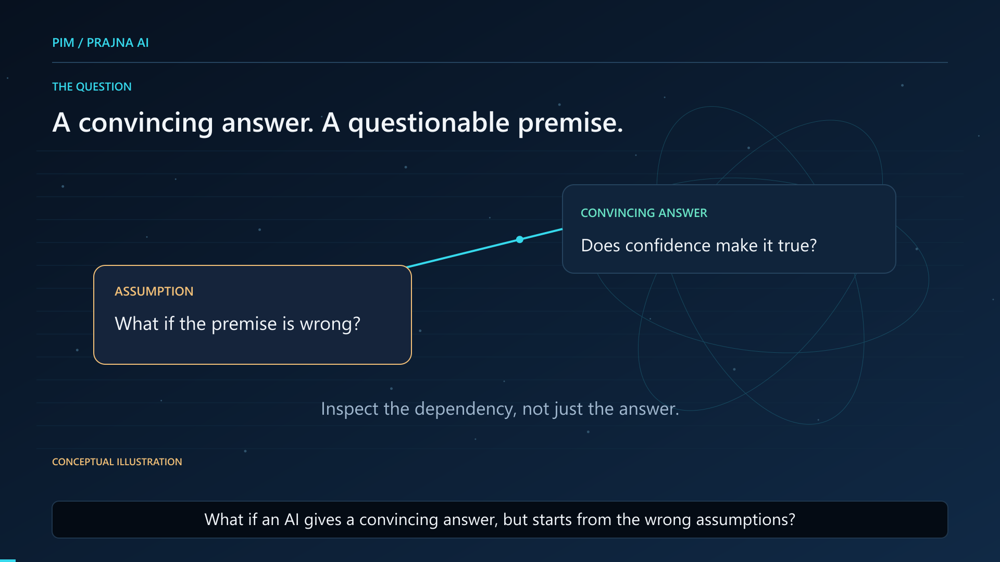

# PIM / Prajna AI v0.2 — English Animated Explainer

[Repository overview](../README.md) · [Runnable research showcase](../showcase/README.md)

## Watch the complete film

- [Watch on YouTube](https://www.youtube.com/watch?v=7fXS9Q3H0HA)
- [Open or download the complete 1080p MP4](../media/research-film/PIM-Prajna-AI-v02-English-Explainer-1080p-v01.mp4)
- [English subtitles (SRT)](../media/research-film/captions.en.srt)
- [Media integrity manifest](../media/research-film/manifest.json)
- [Development roadmap v0.2](https://app.notion.com/p/40abaa9ca5ec8091ac67e29948741839)

The preview opens YouTube. The MP4 is also stored in this repository; use GitHub's download control if the file page does not play it.

## What the film explains

A convincing answer can still rest on an incorrect premise. The v0.2 roadmap asks how an AI system could make assumptions explicit, record predictions, choose informative experiments, check outcomes, and revise hypotheses in response to evidence.

The animated sequence illustrates that proposed research loop. It is an explanation of the research plan, not a screen recording of a completed autonomous discovery system.

| Evidence level | Scope presented in the film |
| --- | --- |
| Bounded implemented prototypes | Finite symbolic search, contract and constraint checks, operation-cost accounting, auditable records, and three scripted offline policies in the wider research program. |
| Scoped engineering evidence | The film cites 73 scoring-alignment tests: 36 new tests and 37 related regressions. This is an existing result for that component, not a test run performed for this media update or a claim that this public showcase contains that component. |
| Preserved research limitation | The historical finite-domain development pilot did not demonstrate a PIM performance advantage. Engineering checks do not establish general understanding, independent scientific replication, or superiority over other AI systems. |
| Proposed research | Active experiment selection, evidence-driven hypothesis revision, and controlled comparisons of reasoning cost and benefit remain research questions. |

PIM is a system-level research prototype, not a newly trained foundation language model. The public [showcase](../showcase/README.md) exposes selected finite checks and proposal-only contract versioning; the film describes a broader program whose components are not all distributed here.

## Media details and disclosure

| Item | Detail |
| --- | --- |
| Edition | v0.2 English animated explainer, master v01 |
| Duration | 232.751020 seconds (approximately 3:53) |
| Picture | 1920 × 1080, 16:9, H.264 |
| Audio | Full original supplied English narration, converted to AAC; no new voice performance or speed change for the video |
| Captions | Visible English captions and a separate 46-cue SRT |
| Visuals | Authored motion infographics, diagrams, text, and supporting presenter portrait |
| AI disclosure | AI-generated voice and AI-assisted visuals; no lip-sync performance |

The existing production QA records matching audio/video presentation endpoints, complete caption text coverage, and a successful full media decode. Caption clause timing is editorially estimated; these checks are not independent human listening or word-level alignment certification. No media rerender or research test was performed for this repository integration.

## Version and integrity

This edition replaces the earlier three-minute photo-and-narration film in the current repository. Its old MP4 and thumbnail have been removed from the current branch, and its subtitles and manifest have been replaced. Earlier versions remain recoverable through Git history.

The MP4 SHA-256 is:

`ed9ace6b76976365d07a5b921c5bd69b691e138305fb7d2007fedb86199f5427`

The manifest records byte counts and SHA-256 values for the MP4, preview, and subtitles. It identifies the repository master, not YouTube's transcoded copies. Hashes detect byte differences; they do not establish immutable storage, scientific validity, or unrestricted redistribution rights.

Researchers and developers are welcome to discuss concrete hypotheses, counterexamples, and reproducible tests through this repository's [Issues](https://github.com/luciferyu666/prajna-insight-model/issues). Please keep private research records, credentials, and personal review evidence out of public discussions.
